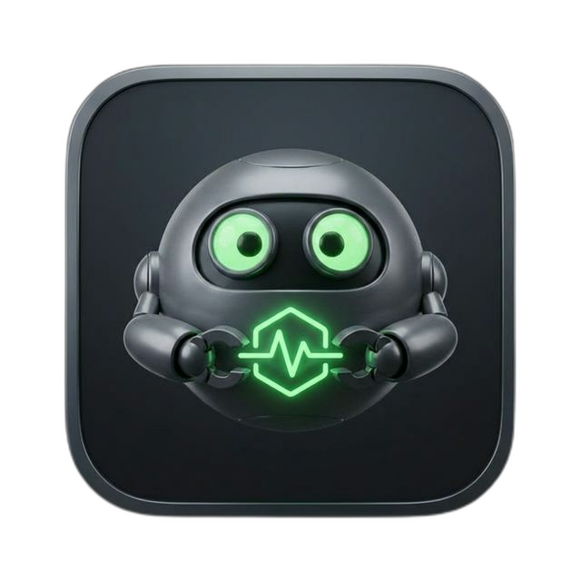

<p align="center">
  
</p>

# PulseGrab — Universal Download Manager for Emby, Plex & Jellyfin

[](https://github.com/h3x4d3x4/PulseGrab/releases)
[](LICENSE)
[](https://greasyfork.org/en/scripts/573086-pulsegrab-universal-download-manager)
[](https://github.com/h3x4d3x4/PulseGrab)

> **A powerful browser userscript that turns any Emby, Plex, or Jellyfin media server into a direct download hub.** Grab movies, TV shows, music, photos, and entire libraries — straight from the browser with zero extra software. Transfer server-to-server directly into your own NAS, or use built-in concurrent downloads, JDownloader integration, wget/curl script generation, QR codes, and 10+ export formats.

**If PulseGrab saves you time, consider supporting development:**

[](https://ko-fi.com/hexadexa)
[](https://github.com/sponsors/h3x4d3x4)

## Current Version: **v1.3.0**

**Latest Release**: [PulseGrab.user.js](https://github.com/h3x4d3x4/PulseGrab/raw/main/releases/PulseGrab.user.js)

---

## Changelog

### v1.3.0
**Server-to-server transfers and search results.**

* **Send to My Server** — hand the download list to aria2 or My.JDownloader on your NAS; the files never pass through your browser and keep transferring after you close the tab.
* **Search results are downloadable** — grab every match at once, scoped to the active tab (Movies, Shows, Episodes or All). Series are expanded by parent, so a show search collects every episode.
* Fixes: series expansion on Emby returned seasons instead of episodes; Jellyfin search views are detected; Plex search says "not supported yet" instead of failing oddly.

### v1.2.0
**Guided setup, and a destination picker that knows your libraries.**

* **Guided Setup wizard** — pick your transport and platform in plain language, then follow six steps that each *verify themselves*. It opens automatically if you hit Send with nothing configured. Covers TrueNAS, Unraid, Synology and plain Docker.
* **TrueNAS one-click install** — paste a TrueNAS API key and PulseGrab deploys the whole thing itself: config folder, app, verification. No terminal at all. The key is **never stored** — it can create containers as root, so it is used for the install and discarded.
* **One command on any other server** — a single block you paste into a shell. The compose file is self-contained: a throwaway init container writes aria2's config and the mover script on first start, so there is no `chmod`, no config editing and no restart afterwards. Works on Unraid, Synology, Debian, a Pi, a VPS.
* **Reads your actual libraries** — point PulseGrab at your own Emby, Jellyfin or Plex and it discovers your real library names, types and paths. No more typing `Filmes` from memory, and no more guessing that a library called `Séries` lives at `/media/Series`.
* **Folder browser** — navigate your server's real filesystem to pick a destination, with **+ New folder** for creating one (it's created when the first file lands). Requires an admin API key for Emby/Jellyfin; library discovery works with any key.
* **Sorting rules** — `Anime => Anime Series` sends anything matching "Anime" there. Content type is corrected automatically against your discovered libraries, so with an `Anime Filmes`/`Anime Series` pair a single rule routes films and episodes to the right half.
* **Remembers where each show goes** — send season 2 of something and the picker is already filled in with where season 1 went. Keyed on the series, so it follows the show across source servers. Mixed batches still ask.
* **Warns about split libraries** — if a show already exists somewhere else on your server, the picker says so before you scatter it across two folders.
* **Pinned folders** — star the ones you use constantly and they sort first everywhere.
* **Choose what to send** — a dedicated selection dialog with tri-state ticking at series, season and individual-item level, plus search, running count and total size. Kept deliberately separate from the Download Manager, whose Start buttons pull files to *your computer*.
* **Folder Per Film toggle** — libraries that keep films loose in the library root instead of one folder per film are now matched rather than fought.
* **Collision check reads files, not just folders** — it normalises titles (stripping extensions and release tags like `1080p`, `BluRay`, `x264`) so `Dune.2021.1080p.BluRay.mkv` is recognised as `Dune (2021)`, and it tells you what the existing copy is called.
* **Duplicate sends are skipped** — re-sending a season no longer produces a batch of "File exists, but a control file does not exist" failures; already-queued files are detected and dropped.
* **Jellyfin and Plex support** for discovery and browsing. Jellyfin uses the `Authorization` header rather than the deprecated `api_key` query parameter, so it won't break when that is removed.
* **Escape closes dialogs** — and only the topmost, so closing the folder browser doesn't discard the destination picker underneath it.
* Fixes: `host:port` typed without a scheme now tries HTTP before HTTPS instead of assuming TLS; the aria2 connection test detects and corrects a wrong HTTPS setting; failed setup checks no longer overwrite a working configuration; and the mover script now lives in `/config/script/`, because the aria2 image resets permissions on `/config/*` at every start and was silently stripping its execute bit.

### v1.1.0
**Send to My Server — server-to-server transfers.** Pull media from someone else's Emby/Plex/Jellyfin straight into your own NAS. The files never pass through your browser or your computer: PulseGrab hands the link list to a downloader on your box, which fetches the media itself at full server speed. Close the tab, shut the laptop — the transfer keeps running.

Two transports, chosen in **Settings → My Server**:

| | **MyJDownloader** (default) | **aria2** |
|---|---|---|
| Server setup | Install JDownloader, sign in | Container + hook script |
| Open ports / firewall | **None** | RPC port on your LAN |
| Works away from home | **Yes** | LAN or VPN only |
| Partial-file handling | Automatic (`.part` files) | Staging folder + move hook |
| Live progress in PulseGrab | In JDownloader / my.jdownloader.org | **Full in-page panel** |
| Links leave your network | Via JD's encrypted relay | **Never** |

* **MyJDownloader — zero server-side setup.** Enter your My.JDownloader email and password, click Connect, pick your machine, set a destination folder. No ports to open, no firewall rules, no hook script, and it works even when you're not on the same network as your NAS. Files are grouped into one package per destination folder, so `destinationFolder` places each season and movie exactly where it belongs. **Your password is never stored** — only the two SHA-256 secrets derived from it, which can't be reversed back into it. Sessions that lapse are re-established transparently.
* **One-click send** — a new **Send to My Server** button in the results dialog. Works because PulseGrab's download URLs carry their auth in the query string (`api_key=` / `X-Plex-Token=`), so they're self-contained and need no header forwarding.
* **Lands in your library, correctly foldered** — reuses the existing naming templates and folder logic, so files arrive as `TV Shows/<Series>/<Season>/…`, `Movies/<Title> (<Year>)/…`, `Music/<Artist>/<Album>/…` — already Emby-shaped and ready to scan.
* **No half-finished episodes in your library** — downloads land in a hidden `.pulsegrab-incoming/` staging folder (media servers skip dot-prefixed directories), and a shipped `on-download-complete` hook moves each file into place the instant it finishes. Because staging lives inside the library dataset, the move is an atomic rename.
* **External subtitles come along** — each item's `.srt`/`.ass` tracks are queued alongside the video and land in the same folder, matching what the built-in manager does. (`dlExternalSubtitles` is on by default, so skipping them would have silently dropped subs for most users.)
* **Live transfer panel** — overall progress, aggregate speed, ETA, per-file bars, and per-file error messages, polled from aria2. Progress is weighted per file, so it doesn't spike to 100% on the first item and collapse as the rest report their sizes. Queueing a second batch folds into the open panel rather than orphaning the first. Cancel-remaining included; closing the panel doesn't stop the transfer.
* **Download history is recorded as files land**, so **Skip already downloaded** works for server transfers too — and a transfer you close the tab on still records whatever arrived before you left.
* **Errors that tell you what's actually wrong** — before queueing the full batch, PulseGrab sends one probe item and watches it. If your server can't resolve or reach the source, you get *"`<your-server>` can't reach `<source>` — this transfer runs server-to-server, not through this browser"* instead of 400 silent failures. Expired session tokens and loopback-only media server addresses are detected and named explicitly too.
* **Generated setup, matched to your settings** — **Settings → My Server** has copy buttons for a ready-to-paste Docker Compose file (TrueNAS: Apps → Discover → Custom App → Install via YAML) and the move hook, both filled in with the port, secret, and library path you entered. **Test Connection** verifies aria2 answers *and* warns if the move hook isn't installed.
* **Library-safe defaults** — `auto-file-renaming=false` so a re-queue never litters `S01E01.1.mkv` next to the real file, and one connection per source server by default so you don't hammer a box you don't own.
* **Robust inputs** — the server address accepts anything you'd paste (`truenas.local`, `192.168.1.50:6800`, `http://nas/`, IPv6 literals), and the generated compose/hook snippets are properly quoted, so secrets containing `:` or `#` and library paths containing spaces don't corrupt them. Items with no resolvable download URL are counted and reported instead of failing opaquely.
* **JDownloader can now target a remote host** — the previously hardcoded `127.0.0.1`/`localhost` is now a **JDownloader Host** setting, so the JDownloader2 app on a NAS works too. Note that JDownloader binds its FlashGot listener to loopback by default; the remote instance needs `ExternInterfaceLocalhostOnly` set to false in Advanced Settings first.
* Added `@connect *` for user-configured server addresses — Tampermonkey asks once per host and offers "Always allow all domains".

### v1.0.10
Full audit pass across Emby, Plex, and Jellyfin — bug fixes, correctness, and polish.
* **JDownloader now detected on macOS** — detection hit `http://localhost:9666`, which resolves to IPv6 `::1` first on macOS, but JDownloader's FlashGot server binds IPv4 `127.0.0.1` only, so it was never reached. Now tries `127.0.0.1` first with a `localhost` fallback and caches the host that answers. Also fixed auto-detect writing the wrong setting key (`enableJDownloader` vs `jdownloaderEnabled`), which meant detecting JD never actually armed the send path.
* **Stops injecting on non–media-server pages** — added a runtime guard so the floating button only appears when a real Emby/Plex/Jellyfin client is detected, instead of on any page whose URL merely contains `/web/`.
* **Folder/collection pagination no longer truncates** — when a server omitted `TotalRecordCount`, scanning stopped after the first page and silently dropped items. Now keeps paging while full pages are returned.
* **Correct IDs on Jellyfin / GUID servers** — item/season detection handled only numeric IDs (`\d+`) and matched the `id=` inside `serverId=`/`parentId=`; both fixed so GUID-based servers resolve the right item.
* **Emby Connect `userId` fallback** — resolves UserId from additional ApiClient fields and stored credentials to avoid the unscoped `/Items/{id}` 404 on remote/non-admin sessions.
* **Generated scripts fixed & hardened** — the Python rename script was invalid Python (`try {` braces); `.sh`/`.bat` renamers now sort files by JDownloader's numeric order instead of grouping by extension; URLs and paths in all wget/curl/PowerShell/Python output are properly quoted/escaped.
* **Download Manager reliability** — removing items mid-download no longer corrupts other downloads' progress; "Cancel All" and closing the manager now actually abort in-flight downloads (previously they kept streaming); removed a duplicate keyboard handler that double-fired Escape/Space and leaked.
* **UI/UX polish** — fixed broken CSS so the progress bar fills correctly and error rows render; QR codes now load via `@require` (page CSP previously blocked them); download history is corruption-safe and capped; notifications are click-to-dismiss and screen-reader announced; Season 0 (Specials) is no longer mislabeled as Season 01.

### v1.0.9
* **Stop showing the "update available" banner after you've already updated** — the cached update result was returned blindly within the 24h check interval, so once a version was announced, the banner kept showing on every page load until the cache expired — even after the user actually installed that version. Now the cache is validated against the running `SCRIPT_VERSION`: if the cached "available" version is no longer newer than what's installed, the cache is cleared and treated as "no update."
* **Check Now dismisses stale banners** — clicking **Check Now** with a fresh result of "up to date" now also removes any older update banner left over from a previous auto-check on the same page.

### v1.0.8
* **Pass `userId` in show/season ID async fallback** — v1.0.7's new resolver called `getItemInfo` without a `userId`, so it hit the unscoped `/Items/{id}` endpoint which 404s on Emby Connect / non-admin user contexts. Now passes `userId` from `getServerAndToken()` so the fallback uses `/Users/{userId}/Items/{id}`, matching the rest of the codebase.

### v1.0.7
* **Fixed show/season ID detection on `app.emby.media`** — `parseIdsFromPage()` extracted the show ID from a `div.itemBackdrop` element's CSS `style` attribute. On the Emby cloud client (and other layouts that don't render the backdrop with the parent show's image URL), no match → "Could not detect show/season IDs" error when clicking **Get Links** on a TV show page. Added an async fallback that uses the URL `id=` + `Items` API to resolve `showId` / `seasonId` from `Type` (`Series` / `Season` / `Episode`) — works regardless of DOM rendering.

### v1.0.6
* **Fixed About-dialog version display** — `SCRIPT_VERSION` was hardcoded to `'1.0.2'` and never bumped on releases, so the About dialog and console log message kept showing 1.0.2 regardless of what was actually installed. Now derived dynamically from `GM_info.script.version` (the `@version` metadata header), so the metadata header is the single source of truth.

### v1.0.5
* **Stable update URL** — `@updateURL` and `@downloadURL` now point to a single stable filename `PulseGrab.user.js` instead of a per-version URL. Previous releases hardcoded their own filename, so each version bump silently broke auto-update for older installs (404). With v1.0.5 onward, version bumps no longer affect the update path.
* **One-click in-app updates** — clicking **Install Update** now navigates directly to the userscript URL, which Tampermonkey/Violentmonkey intercept with their native install prompt. No more downloading a `.js` to your downloads folder and opening it manually.
* **Cleaner `@connect` list** — removed `release-assets.githubusercontent.com` and `objects.githubusercontent.com` since the in-app updater no longer hits the GitHub release-asset CDN.

### v1.0.4
* **In-app updater fix** — added `@connect release-assets.githubusercontent.com` and `@connect objects.githubusercontent.com`. The GitHub Releases asset API redirects to those hosts, and userscript managers were blocking the redirect, so clicking **Install Update** failed with a "Refused to connect / not whitelisted URL" error.

### v1.0.3
* **JDownloader fix** — added `@connect localhost` and `@connect 127.0.0.1` to the userscript header. Userscript managers were blocking GM_xmlhttpRequest calls to `http://localhost:9666/flashgot`, breaking the "Send to JDownloader" action.

### v1.0.2
* **In-app update checker** — automatically checks GitHub Releases for new versions on each load with one-click install. Configurable check interval and manual "Check Now" button in Settings.
* **Music library support for Plex** — full artist-to-album-to-track expansion now works for Plex music libraries. Previously, music libraries returned "No downloadable media files found" because `MusicArtist` items were not expanded into their tracks.
* **Music library support for Emby/Jellyfin** — recursive artist and album expansion with proper `IncludeItemTypes=Audio` filtering.
* **Settings UI** — new "Updates" section with GitHub PAT input, auto-check toggle, check interval, and manual "Check Now" button.
* **About modal** — now shows whether PulseGrab is up to date or if a newer version is available.
* **Version display fix** — the console loaded message now dynamically uses `SCRIPT_VERSION` instead of a hardcoded string.

### v1.0.1
* Added Plex home page server discovery — "Get Links" now works on `app.plex.tv` home page by discovering servers via the `plex.tv/api/v2/resources` API with a server picker dialog for multi-server accounts.
* Fixed `detectPageTypePlex()` returning `unknown` for empty/missing hash on `app.plex.tv`.
* Fixed Plex music library type mapping (`artist` is now correctly mapped to `music`).
* Fixed double `processFunction()` execution that was doubling all API calls.
* Fixed `originalItems` undefined `ReferenceError` in bypass button handler.
* Fixed `processQueue()` undefined — corrected to `startNextDownload()`.
* Fixed `gmFetch().json()` crash on non-JSON responses with try/catch wrapper.
* Fixed `parallelFetch` deadlock on rejected tasks by using `.finally()` for cleanup.
* Fixed duplicate `searchInput` event listener in Download Manager.
* Fixed null download URL crash for Plex containers without `_plexPartKey`.
* Fixed Plex photo `MediaType` (was `Video`, now correctly `Photo`).
* Added missing `@grant GM_deleteValue` and `@grant GM_listValues` declarations.
* Added missing `episodes` argument to `showConfirmDialog` in Plex `processShow` path.
* Added `return null` guard in `EXTRACT_SUBTITLES` for Plex subs without `_plexStreamKey`.
* Renamed `_embyGrabLargeFolderConfirmed` to `_pulseGrabLargeFolderConfirmed`.
* Fixed `fetchAllLibraries()` Emby branch to use `apiPrefix()` consistently.

### v1.0.0
* Initial PulseGrab release — universal rewrite of EmbyGrab with full Plex and Jellyfin support.
* Server auto-detection (Emby, Plex, Jellyfin) with adaptive theming.
* Plex API layer: auth token interception via fetch/XHR/WebSocket hooks, item normalization to Emby's canonical shape, download URL construction via `/library/parts/` endpoints.
* Jellyfin support via dynamic API prefix (drops `/emby/` path segment).
* Storage migration from EmbyGrab (`emby_dl_*`) to PulseGrab (`pulse_dl_*`) keys.
* Server-adaptive accent themes: Emby Green, Plex Amber, Jellyfin Purple.

---

## Quick Start

1. **Install a Userscript Manager** — [Tampermonkey](https://www.tampermonkey.net/), [Violentmonkey](https://violentmonkey.github.io/), or Greasemonkey in Chrome, Edge, Firefox, or Safari.
2. **Add the script** — install from [Greasy Fork](https://greasyfork.org/en/scripts/573086-pulsegrab-universal-download-manager) (recommended) or download from [GitHub Releases](https://github.com/h3x4d3x4/PulseGrab/releases/latest).
3. **Navigate** to your Emby, Plex, or Jellyfin server in the browser.
4. **Click** the floating **"Get Links"** button that appears on any media page.

**Detailed Setup**: [Quick Start Guide](guides/PULSEGRAB-QUICK-START.md)

---

## Supported Servers

| Server | Status | Auth Method |
|--------|--------|-------------|
| **Emby** | Full support | API key from page context |
| **Plex** | Full support | Token captured via fetch/XHR/WebSocket interception |
| **Jellyfin** | Full support | API key from page context (no `/emby/` prefix) |

PulseGrab auto-detects which server you're using and adapts its API calls, URL construction, theme colors, and UI accordingly.

---

## Key Features

### Server-to-Server Transfer
Pull media from any server you have access to straight into your own NAS — the files never pass through your browser or computer. Via **MyJDownloader** there is nothing to configure on your server at all: no open ports, no firewall rules, and it works from anywhere. Power users can point PulseGrab at an **aria2** daemon instead for a fully local transfer with live in-page progress. Either way files arrive already foldered for Emby/Jellyfin/Plex, external subtitles included, and your library never sees a half-finished episode. Close the tab; the transfer keeps running.

### Download Methods
| Method | Description |
|--------|-------------|
| **Send to My Server** | Server-to-server transfer straight into your own NAS via aria2 — bytes never touch your browser or computer |
| **Built-in Manager** | Concurrent in-browser downloads with pause, resume, retry, and progress tracking |
| **JDownloader** | One-click send to a running JD2 instance via local API socket |
| **wget / curl Scripts** | Generate ready-to-run terminal scripts (`.bat`, `.command`, `.sh`) with correct filenames |
| **aria2** | Export as aria2 input file for accelerated multi-connection downloads |
| **Clipboard** | Copy all URLs in your chosen format |
| **QR Code** | Scan links on mobile for cross-device transfers |
| **Email** | Send a batch of download links via `mailto:` |

### Export Formats
Plain URLs, M3U8 playlist, JSON, HTML, CSV, XML, wget script, curl script, aria2 input, JDownloader package

### Content Support
- **Movies** — single files with year, resolution, and codec metadata
- **TV Shows** — entire series, individual seasons, or single episodes with S01E01 naming
- **Music** — full artist-to-album-to-track expansion for all three server types
- **Collections & BoxSets** — recursive expansion including nested series/seasons
- **Photos** — Plex photo libraries with correct MediaType handling
- **Libraries** — download an entire library with progress tracking
- **Server root** — download everything on the server (with large-batch confirmation dialog)

### Download Manager
The built-in browser downloader provides a complete download experience:

- **Stats View** — real-time stat cards (Total / Done / Active / Queued / Failed), segmented color progress bar with legend, per-folder breakdown table, and a live "Currently Downloading" panel with per-item speed and ETA
- **Per-item Controls** — context-aware buttons: Start, Pause, Stop, Retry, Dismiss, Re-download
- **Concurrent Downloads** — configurable 1–5 parallel streams
- **Search & Filter** — search within results, filter by status tab
- **Keyboard Shortcuts** — `Ctrl+D` open manager, `Ctrl+H` toggle history, `Ctrl+S` open settings, `Esc` close panels
- **Overall ETA** — live estimate shown in the status bar during downloads

### Smart Features
- **Bypass Mode** — Strict DirectPlay bypass for servers that restrict direct downloads
- **Download History** — local tracking with export; optionally skip already-downloaded files
- **Selective Download** — checkbox any item or group, then download only the selected items
- **Smart Grouping** — TV Shows grouped by season, Music by artist/album, Movies together
- **Background Prefetch** — pre-fetches item metadata before you click "Get Links"
- **Request Caching** — avoids redundant API calls within a session
- **Parallel Fetching** — concurrent season/album fetching for faster scanning of large libraries
- **In-app Updates** — automatic update checking via GitHub Releases API with one-click install

### Appearance
- **Dark Mode** — full dark/light theme toggle across all panels and dialogs
- **Server-adaptive Themes** — auto-detects your server type and applies matching accent colors
- **Theme Options** — Emby Green, Plex Amber, Jellyfin Purple, Ocean Blue, or Auto
- **Compact Mode** — condensed UI layout for smaller screens

---

## Settings Reference

| Section | Key Options |
|---------|-------------|
| **General Basics** | Button position, default output format, batch size, concurrent downloads (1–5), auto-confirm, rate limiting, debug logging |
| **Appearance** | Accent theme (Auto / Emby / Plex / Jellyfin / Ocean), dark mode, compact view |
| **Filters & History** | Download history tracking, skip-downloaded, exclude extras, quality preset floor (Any / 720p / 1080p / 4K+), file-size min/max thresholds |
| **My Server** | Guided Setup wizard; transfer method (MyJDownloader / aria2); MyJD email, password, device picker, destination folder with Browse; aria2 address, RPC port, secret, HTTPS toggle, library path, connections per file, live panel toggle, connection test, generated compose/hook snippets |
| **Naming Templates** | Filename macros; connect your own server for library discovery; per-type library folders with Browse; folder-per-film toggle; pinned folders; sorting rules; ask-before-each-transfer toggle |
| **JDownloader** | Enable/disable local API socket, auto-detect, custom host, custom port |
| **Naming Templates** | Customizable episode and movie filename macros with substitution tokens |
| **Subtitles** | External subtitle downloads, language selection grid |
| **Updates** | Auto-check toggle, check interval, manual check button |

---

## In-App Updates

PulseGrab automatically checks for new versions via the GitHub Releases API:

1. Updates are checked on every script load (respecting a configurable interval, default: 24 hours)
2. When a new version is detected, a notification banner appears with a changelog preview and an **Install Update** button
3. Clicking **Install Update** downloads the latest release and triggers Tampermonkey's install prompt
4. You can also manually check via **Settings → Updates → Check Now**
5. Auto-checking can be disabled in **Settings → Updates**

---

## Project Structure

```
PulseGrab/
├── README.md                         # This file
├── assets/
│   └── pulsegrab_logo.png            # Project logo
├── releases/
│   ├── PulseGrab.user.js             # Stable URL — always serves the latest release
│   ├── PulseGrab v1.0.4.js           # Per-version archive (kept for legacy install URLs)
│   └── EmbyGrab v1.0.1.js            # Legacy Emby-only version
├── guides/
│   ├── PULSEGRAB-QUICK-START.md      # Installation & first-use guide
│   ├── JDOWNLOADER-SETUP-GUIDE.md    # JDownloader 2 integration setup
│   ├── COLLECTION-404-FIX.md         # Troubleshooting collection errors
│   └── WGET-CURL-DOWNLOAD-GUIDE.md   # Terminal download scripts guide
└── .gitignore
```

---

## Common Use Cases

### Transfer From Someone Else's Server Into Your Own NAS — the easy way

1. Install **JDownloader2** on your NAS — on TrueNAS it's a one-click app under **Apps → Discover**. Open it and sign in under **Settings → My.JDownloader** (free account at `my.jdownloader.org`).
2. In PulseGrab: **Settings → My Server**, enter the same email and password, click **Connect & List Devices**, pick your machine, and set the destination folder (your library root as the JDownloader machine sees it).

That's it — no ports, no config files. Now on any Emby/Plex/Jellyfin server you have access to: **Get Links → Send to My Server**.

### …or with aria2 (fully local, live progress)

One-time setup on the destination box (example: TrueNAS running Emby):

1. **Settings → My Server** in PulseGrab — enter your NAS address, an RPC port (6800), a secret, and the library path *as seen inside the aria2 container* (e.g. `/downloads`).
2. Click **Copy compose YAML**, then on TrueNAS go to **Apps → Discover → Custom App → Install via YAML** and paste it. Point the library volume at your media dataset and set `PUID`/`PGID` to the user Emby runs as (`568:568` on TrueNAS) so Emby can read the files.
3. Click **Copy hook script**, save it as `/config/pulsegrab-move.sh`, `chmod +x` it, and add `on-download-complete=/config/pulsegrab-move.sh` to `/config/aria2.conf`.
4. Restart the app and hit **Test Connection**.

Then, from any Emby/Plex/Jellyfin server you have access to: click **Get Links**, then **Send to My Server**. Files transfer directly from that server to yours, arriving correctly foldered in your library. You can close the browser.

> **The destination needs its own route to the source.** The transfer does not go through your browser, so a media server that only your laptop can reach (VPN-only, or a LAN address your NAS can't see) won't work. PulseGrab probes one file first and tells you explicitly if this is the problem.

### Download an Entire TV Series
1. Navigate to the TV show page on your Emby, Plex, or Jellyfin server
2. Click **Get Links** — PulseGrab expands all seasons and episodes automatically
3. In the Results dialog, click **Download Manager**
4. Press **Start** — episodes download concurrently (up to 5 parallel streams)

### Download a Music Library
1. Navigate to your Music library page
2. Click **Get Links** — PulseGrab expands all artists → albums → tracks
3. Choose your preferred format (direct download, M3U8 playlist, wget script, etc.)

### Selective Episode Download
1. Open the Download Manager from the Results dialog
2. Check only the items you want
3. Click **Selected** in the toolbar — only checked items download

### Send to JDownloader
1. Enable JDownloader in **Settings → JDownloader**
2. Ensure JDownloader 2 is running with the RemoteAPI enabled on port 9666
3. Click **Send to JDownloader** in the Results dialog — files appear with correct folder structure

### Download from Plex Home Page
1. Navigate to `app.plex.tv` (the main Plex home page)
2. Click **Get Links** — PulseGrab discovers your servers via the Plex API
3. If you have multiple servers, pick one from the server picker dialog
4. All libraries are scanned and expanded into downloadable items

---

## Contributing

Found a bug or want a feature?

1. Test with the latest version from [Releases](../../releases)
2. Reproduce with **Debug Logging** enabled (Settings → General Basics)
3. Open an issue with console logs and steps to reproduce

---

## Disclaimer

PulseGrab is a tool for managing downloads from media servers you have authorized access to. The developers are **not responsible** for any misuse. Users are solely responsible for ensuring they have the legal right to download any content. Use responsibly and in accordance with your server's terms of service.

---

## License

[MIT License](LICENSE) — free to use, modify, and distribute.

---

**Enjoy seamless media server downloads with PulseGrab!**
